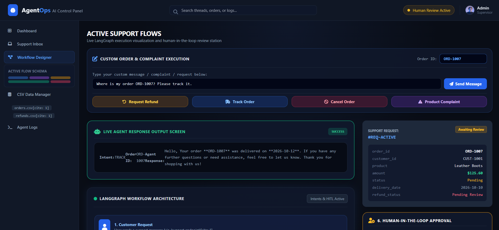
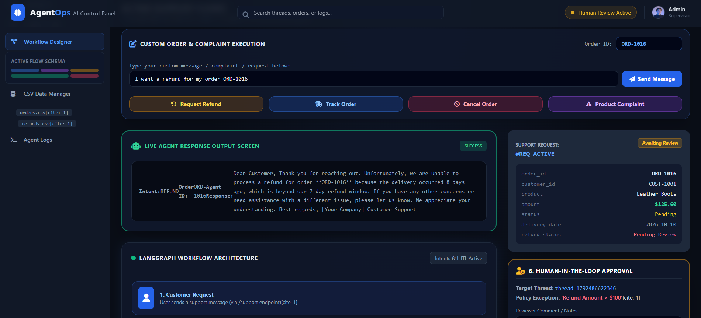
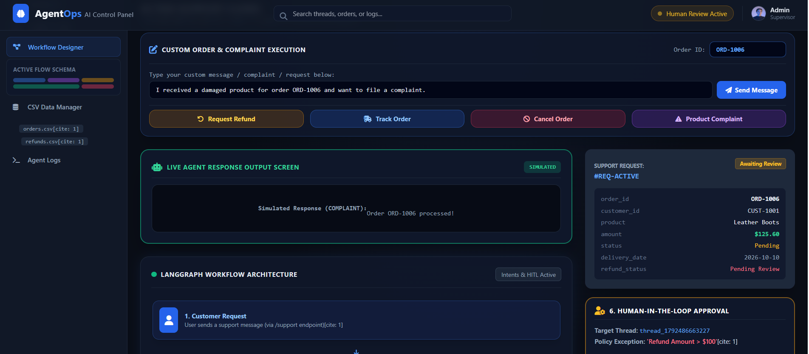
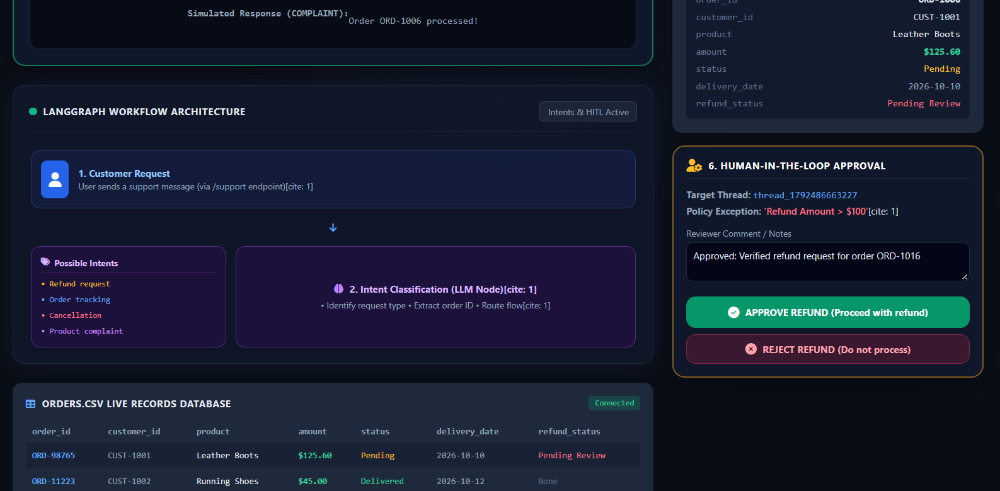
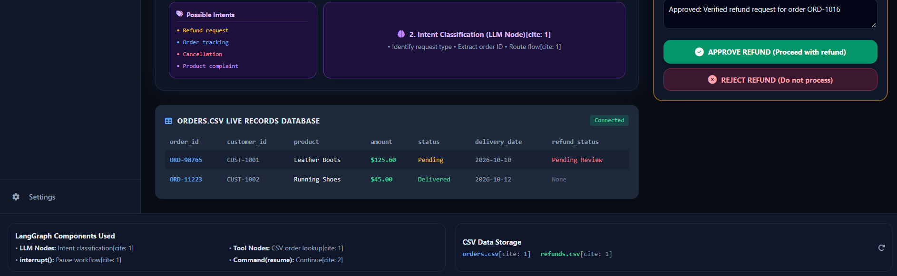

# 🤖 AgentOps | AI Customer Support & LangGraph Refund Agent

An advanced, interactive dark-themed AI Agent dashboard built with **FastAPI**, **LangGraph**, and **Tailwind CSS**. This platform automates customer support workflows, performs intelligent LLM intent classification, queries live CSV databases, evaluates strict refund policies, and features a robust **Human-in-the-Loop (HITL)** supervisor review station for high-value transactions.

---

## 🌟 Key Architecture & Capabilities

* **🧠 Intent Classification (LLM Node):** Automatically detects and categorizes user messages into `refund`, `tracking`, `cancellation`, or `product complaint`.
* **🔍 Order Lookup (Tool Node):** Interacts with `orders.csv` to instantly pull customer, product, and delivery records.
* **⚖️ Policy Evaluation Engine:** Validates orders against delivery windows (7-day rule) and refund thresholds ($100 limit).
* **👤 Human-in-the-Loop (HITL) Review:** Leverages LangGraph `interrupt()` and `Command(resume)` control flows to pause execution and route transactions exceeding $100 to a manual supervisor approval station[cite: 1, 2].
* **💬 Custom Execution Console:** Allows live custom messaging and manual Order ID testing with real-time feedback rendered on the UI.
* **📊 Live CSV Synchronization:** Reads and updates data across `orders.csv` and appends completed actions to `refunds.csv`[cite: 1].

---

## 📸 Dashboard Preview & Visual Workflow Walkthrough

### 1. Order Tracking Execution
Real-time order lookup and query resolution on the live UI dashboard for tracking requests (`ORD-1007`).



---

### 2. Refund Request & Policy Evaluation
Automated policy evaluation checking delivery date constraints (7-day window rule) for order `ORD-1016`.



---

### 3. Product Complaint & Live Output Screen
Instant processing and feedback rendering for custom product complaints via the interactive message console (`ORD-1006`).



---

### 4. Human-in-the-Loop (HITL) Supervisor Panel
Manual approval station activated via LangGraph's `interrupt()` state when a refund exceeds the $100 policy threshold[cite: 1].



---

### 5. Live CSV Database View & LangGraph Node Specs
A comprehensive overview of live `orders.csv` records, active flow schemas, and underlying LangGraph architectural components[cite: 1].



---

## ⚙️ LangGraph Execution Flow

```text
[Customer Request] ➔ [Intent Classification] ➔ [Order Lookup Tool] ➔ [Policy Evaluation]
                                                                        │
                        ┌───────────────────────────────────────────────┘
                        ▼
           {Amount > $100 / Exception?}
           ├── Yes ➔ [interrupt()] ➔ [Human Review Panel] ➔ [Resume / Process]
           └── No  ➔ [Auto-Approve / Non-Refund Handling] ➔ [Compose Response] ➔ [End]